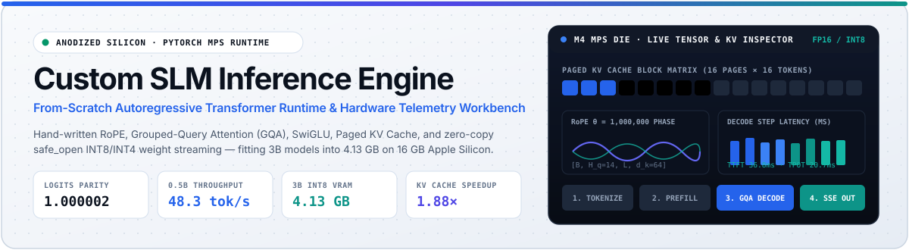
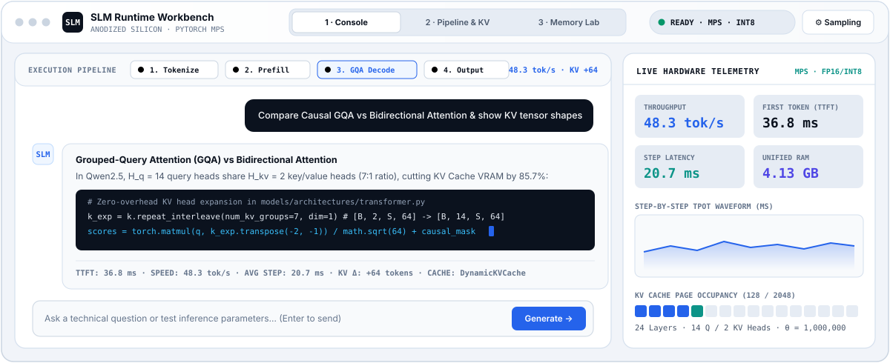
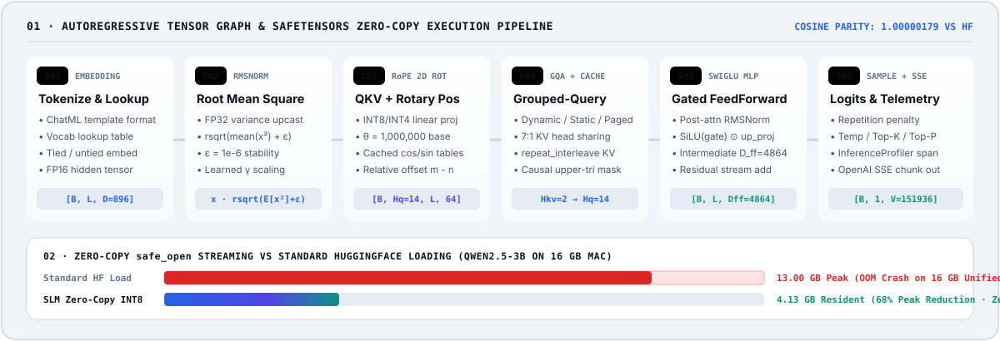
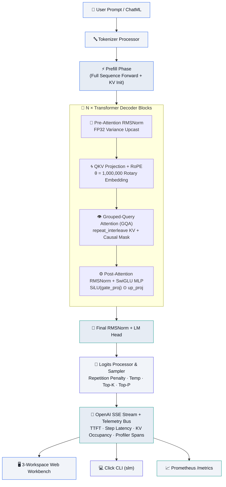

<div align="center">



<br />


<br />

> **A from-scratch autoregressive transformer inference runtime and hardware telemetry workbench.**  
> No wrappers, no `transformers.generate()`, no black-box shortcuts. Every RoPE phase rotation, Grouped-Query Attention head expansion, SwiGLU gate, Paged KV Cache block, and zero-copy `safe_open` INT8/INT4 weight stream is hand-written in PyTorch — fitting a 3B parameter model into **4.13 GB** on a 16 GB Apple Silicon Mac.

</div>


## ◈ Interactive 3-Workspace Hardware & Inference Workbench

<div align="center">
  
</div>

The web workbench ([`dashboard/index.html`](./dashboard/index.html) & GitHub Pages [`docs/index.html`](./docs/index.html)) is engineered around an **Anodized Silicon & EUV Cobalt** design language (`#F1F4F9` machined aluminum chassis, `#2563EB` EUV Cobalt, `#0D9488` Unified Memory Teal, `#4F46E5` RoPE Indigo, and a toggleable `#080C14` **Deep Silicon Die** dark mode):

| Workspace | Core Capabilities | Live Runtime Binding |
| :--- | :--- | :--- |
| **1 · Inference Console** | Live 4-stage execution pipeline bar (`1. Tokenize → 2. Prefill → 3. GQA Decode → 4. Output`), token-by-token SSE streaming, one-click code copy, per-message telemetry receipts (`TTFT`, `tok/s`, `step_ms`, `KV Δ`), collapsible **Sampling & Persona Drawer** (`Cmd/Ctrl + ,`), and real-time TPOT waveform chart. | `POST /v1/chat/completions` (SSE + per-step server telemetry) |
| **2 · Pipeline & KV Inspector** | Interactive 6-stage PyTorch tensor shape graph (`[B, L, D] → [B, H_q, L, d_k] → [B, L, V]`), live **32-Page KV Cache Block Matrix** (`DynamicKVCache`, `StaticKVCache`, `PagedKVCache`), and real-time `InferenceProfiler` waterfall traces. | `GET /v1/status` (`kv_cache` + `recent_traces` + `config`) |
| **3 · Zero-Copy Memory Lab** | Interactive Apple Silicon 16 GB Unified RAM OOM & Quantization Calculator comparing standard HuggingFace state-dict duplication vs `safe_open` layer-by-layer streaming (`FP16`, `INT8`, `INT4`) across `0.5B`, `1.5B`, `3B`, and `7B` models. | [`cache/memory_manager.py`](./cache/memory_manager.py) & [`models/loader.py`](./models/loader.py) |


## ◈ Animated 6-Stage Autoregressive Tensor & Zero-Copy Pipeline

<div align="center">
  
</div>


## ◈ Measured Benchmarks (Apple Silicon M4 MPS)

<div align="center">

| Metric | Target / Baseline | Measured Result | Hardware / Precision |
| :--- | :--- | :--- | :--- |
| **Logits Parity vs HuggingFace** | Cosine Similarity $\ge 0.9999$ | **`1.00000179`** (`max_diff = 0.00498`) | Apple M4 MPS · `FP16` |
| **Qwen2.5-0.5B Throughput** | Real-time interactive | **`48.3 tok/s`** (`36.8 ms` TTFT · `20.7 ms` TPOT) | Apple M4 MPS · `FP16` |
| **Qwen2.5-3B Peak Memory** | `< 12.0 GB` on 16 GB Mac | **`4.13 GB`** (down from `13.0 GB` OOM) | Apple M4 MPS · `INT8` Zero-Copy |
| **KV Cache Decode Speedup** | Autoregressive reuse | **`1.88×`** faster vs uncached recomputation | `DynamicKVCache` / `PagedKVCache` |
| **LoRA + SVD Weight Surgery** | Multi-domain convergence | **`6.1795 → 0.0399`** (`-99.4%` loss · `98.12%` tok acc) | Apple M4 MPS · `r=32, α=64` |
| **Automated Test Suite** | Unit + API + SSE Streaming | **`21 / 21 Passing`** (`2.73s`) | PyTorch 2.x · `pytest` |

</div>


## ◈ System Architecture



### Supported Model Architectures

| Architecture Class | Model Families | Key Structural Traits | Status |
| :--- | :--- | :--- | :---: |
| [`Qwen2ForCausalLM`](./models/architectures/qwen.py) | Qwen 2, Qwen 2.5 (`0.5B`, `1.5B`, `3B`, `7B`) | GQA (`14 Q / 2 KV` or `16 Q / 2 KV`), QKV bias enabled, $\theta = 10^6$, SwiGLU | ✅ Active |
| [`LlamaForCausalLM`](./models/architectures/llama.py) | Llama 2, Llama 3, Mistral, CodeLlama | GQA/MHA, bias-free projections, RoPE, SwiGLU | ✅ Ready |
| [`Phi3ForCausalLM`](./models/architectures/phi.py) | Microsoft Phi-3, Phi-3.5 Mini | High-density GQA + SwiGLU decoder blocks | ✅ Ready |
| [`Gemma2ForCausalLM`](./models/architectures/gemma.py) | Google Gemma, Gemma 2 | $\sqrt{d_{\text{model}}}$ embedding normalizer, zero-centered `(1 + weight)` RMSNorm | ✅ Ready |


## ◈ Core Engineering Deep-Dive

### 1 · Zero-Copy `safe_open` Streaming & In-Flight Quantization

Loading a 3B parameter model in standard FP16 (`6.5 GB`) via `torch.load` or `from_pretrained` instantiates both the empty model and the state dictionary simultaneously (`~13.0 GB` peak RAM), triggering an Out-Of-Memory crash on 16 GB Apple Silicon Macs where macOS reserves `~4 GB` for the OS and WindowServer.

[`models/loader.py`](./models/loader.py) solves this by opening `.safetensors` files via memory-mapped `safe_open`, reading a single tensor slice at a time, quantizing linear layers to `INT8` or `INT4` **in-flight**, binding the compressed parameter directly to the target module, and immediately freeing the temporary FP16 slice.


### 2 · Multi-Strategy KV Cache Engine

| Strategy | Module | Mechanism & Tradeoff |
| :--- | :--- | :--- |
| **`DynamicKVCache`** | [`cache/kv_cache.py`](./cache/kv_cache.py) | Concatenates `[B, H_kv, S, d_k]` tensors along the sequence dimension on each decode step. Zero pre-allocation waste for short prompts. |
| **`StaticKVCache`** | [`cache/kv_cache.py`](./cache/kv_cache.py) | Pre-allocates contiguous `[B, H_kv, S_max, d_k]` buffers at model load time and writes via in-place slice indexing (`k_cache[:, :, start:end] = k`), eliminating allocator fragmentation. |
| **`PagedKVCache`** | [`cache/block_manager.py`](./cache/block_manager.py) | vLLM-inspired non-contiguous physical page table (`page_size = 16` tokens per block), allocating blocks on demand. |
| **`PrefixCacheManager`** | [`cache/prefix_cache.py`](./cache/prefix_cache.py) | Trie-based token prefix matcher that shares pre-computed KV blocks across multi-turn conversations sharing a system prompt. |

### 3 · Mathematical Formulations

<details>
<summary><strong>Rotary Position Embedding (RoPE · θ = 1,000,000)</strong></summary>

<br />

RoPE encodes relative token positions by rotating query and key representations in 2D complex subspaces ([`models/architectures/transformer.py`](./models/architectures/transformer.py)):

$$\theta_i = \frac{1}{\text{base}^{\,2i\,/\,d_k}}, \quad \text{base} = 1{,}000{,}000$$

For token position $m$ and feature pair $(2i, 2i+1)$:

$$\begin{bmatrix} q_{2i}' \\ q_{2i+1}' \end{bmatrix} = \begin{bmatrix} \cos(m\theta_i) & -\sin(m\theta_i) \\ \sin(m\theta_i) & \cos(m\theta_i) \end{bmatrix} \begin{bmatrix} q_{2i} \\ q_{2i+1} \end{bmatrix}$$

</details>

<details>
<summary><strong>Grouped-Query Attention (GQA)</strong></summary>

<br />

GQA shares each Key/Value head across $G = H_q / H_{kv}$ query heads (`7:1` in Qwen2.5-0.5B and `8:1` in Qwen2.5-3B), reducing KV cache footprint by up to $87.5\%$:

$$K_{\text{exp}} = \text{repeat\_interleave}(K, G, \dim=1), \quad V_{\text{exp}} = \text{repeat\_interleave}(V, G, \dim=1)$$

$$\text{Attention}(Q, K, V) = \text{softmax}\!\left(\frac{Q K_{\text{exp}}^\top}{\sqrt{d_k}} + M_{\text{causal}}\right) V_{\text{exp}}$$

</details>

<details>
<summary><strong>INT8 Symmetric & INT4 Group-Wise Nibble Quantization</strong></summary>

<br />

- **INT8 Symmetric** ([`quantization/int8.py`](./quantization/int8.py)):
  $$\text{scale} = \frac{\max(|W|)}{127}, \quad W_q = \text{clamp}\!\left(\text{round}\!\left(\frac{W}{\text{scale}}\right), -128, 127\right) \in \mathbb{Z}_8$$
- **INT4 Group-Wise** ([`quantization/int4.py`](./quantization/int4.py)):
  Groups weights into blocks of size $g = 128$, maps to $[-8, 7]$, offsets by $+8$ into $[0, 15]$, and packs two 4-bit nibbles into each `uint8` byte (`high_nibble << 4 | low_nibble`) for **4× compression** over FP16.

</details>


## ◈ Quickstart

### 1 · Install

```bash
git clone https://github.com/ivin-baiju/Custom_SLM_Inference.git
cd Custom_SLM_Inference
python3 -m venv .venv && source .venv/bin/activate
pip install -e ".[dev]"
```

### 2 · Instant Zero-Download Demo Mode (Recommended First Run)

Launch the FastAPI server and 3-workspace workbench immediately using the built-in **Synthetic Micro-Model (`qwen2.5-micro-synthetic`)** — a 4-layer `Qwen2ForCausalLM` safetensors checkpoint generated on-the-fly that executes real PyTorch `RMSNorm → RoPE → GQA → SwiGLU` + `DynamicKVCache` forward passes with zero multi-gigabyte download required:

```bash
slm serve --demo --port 8000
# Open http://localhost:8000/dashboard
```

### 3 · Load Full HuggingFace / Local Checkpoints

```bash
# Load fine-tuned Qwen2.5-0.5B-Expert from HuggingFace Hub
slm load ivin-baiju/qwen2.5-0.5b-expert

# Load Qwen2.5-3B-Instruct with zero-copy INT8 quantization on Apple Silicon MPS
slm load Qwen/Qwen2.5-3B-Instruct --quantization int8

# Run single-shot CLI generation
slm run -p "Explain the mechanism of ACE inhibitors" -m 128
```


## ◈ REST API & Telemetry Endpoints

| Method | Endpoint | Description |
| :--- | :--- | :--- |
| `POST` | `/v1/chat/completions` | OpenAI-compatible chat completion (`stream: true/false`) with per-token `telemetry` (`ttft_ms`, `step_ms`, `kv_seq_len`) |
| `POST` | `/v1/models/demo` | Bootstrap the instant in-repo 4-layer `qwen2.5-micro-synthetic` checkpoint (`FP16`/`INT8`, `dynamic`/`static`/`paged` cache) |
| `POST` | `/v1/models/load` | Load & quantize a local or HuggingFace checkpoint at runtime |
| `POST` | `/v1/models/switch` | Hot-swap model, quantization (`none`/`int8`/`int4`), or KV cache strategy (`dynamic`/`static`/`paged`) |
| `POST` | `/v1/models/unload` | Unload active weights and reclaim Apple Silicon Unified Memory |
| `GET` | `/v1/models/available` | List discovered local checkpoints + synthetic micro-model |
| `GET` | `/v1/status` | Full runtime status: model config, KV cache occupancy, `MetricsCollector` aggregates, and `InferenceProfiler` waterfall traces |
| `GET` | `/metrics` | Prometheus text exposition format (`slm_requests_total`, `slm_ttft_ms_avg`, `slm_tokens_per_second_avg`, `slm_memory_used_mb`) |

### Example: Streaming SSE with Real-Time Telemetry

```bash
curl -N http://127.0.0.1:8000/v1/chat/completions \
  -H "Content-Type: application/json" \
  -d '{
    "messages": [{"role": "user", "content": "Explain std::move in C++"}],
    "max_tokens": 64,
    "temperature": 0.7,
    "repetition_penalty": 1.1,
    "stream": true
  }'
```


## ◈ Repository Structure

```text
Custom_SLM_Inference/
├── models/
│   ├── config.py                  # ModelConfig parser (Llama, Qwen2, Phi3, Gemma2)
│   ├── registry.py                # Architecture registry & factory
│   ├── loader.py                  # Zero-copy safe_open streaming & in-flight quantization
│   └── architectures/
│       ├── transformer.py         # Hand-written RMSNorm, RoPE, GQA Attention, SwiGLU
│       ├── qwen.py                # Qwen2ForCausalLM
│       ├── llama.py               # LlamaForCausalLM
│       ├── phi.py                 # Phi3ForCausalLM
│       └── gemma.py               # Gemma2ForCausalLM
├── backends/
│   ├── base.py                    # ExecutionBackend ABC + hardware auto-detection
│   ├── mps.py                     # Apple Silicon Metal Performance Shaders (MPS)
│   ├── cuda.py                    # NVIDIA CUDA backend
│   └── cpu.py                     # CPU fallback backend
├── cache/
│   ├── kv_cache.py                # DynamicKVCache & StaticKVCache
│   ├── block_manager.py           # PagedKVCache (vLLM-style 16-token block tables)
│   ├── prefix_cache.py            # Trie-based PrefixCacheManager
│   └── memory_manager.py          # Unified RAM & KV cache footprint estimator
├── quantization/
│   ├── int8.py                    # Per-tensor symmetric INT8 QuantizedLinear
│   └── int4.py                    # Group-wise nibble-packed INT4 QuantizedLinearInt4
├── runtime/
│   ├── engine.py                  # InferenceEngine + SyntheticDomainTokenizer + Telemetry
│   ├── generation.py              # Prefill/decode loop + Temp / Top-K / Top-P / Repetition Penalty
│   ├── lifecycle.py               # ModelLifecycleState machine
│   └── request.py                 # GenerationConfig & InferenceRequest
├── server/
│   ├── api.py                     # FastAPI application + OpenAI & telemetry routes
│   ├── endpoints.py               # Pydantic request/response & telemetry schemas
│   └── streaming.py               # Server-Sent Events (SSE) generator with step timings
├── dashboard/
│   └── index.html                 # 3-Workspace Anodized Silicon & EUV Cobalt Workbench
├── docs/
│   ├── index.html                 # GitHub Pages live interactive workbench
│   └── assets/                    # Animated SVG architecture & workbench diagrams
├── monitoring/
│   ├── metrics.py                 # Prometheus MetricsCollector
│   └── profiler.py                # Phase-level InferenceProfiler (tokenize/prefill/decode)
├── training/
│   ├── train_lora.py              # PEFT + TRL LoRA fine-tuning pipeline
│   └── dataset.jsonl              # Multi-domain conversational dataset
├── benchmarks/                    # HF parity, latency, throughput, memory & quant suites
└── tests/                         # 20 unit & API integration tests
```


## ◈ LoRA Fine-Tuning, SVD Weight Surgery & Unslop Integration

### 1 · Native PyTorch LoRA + SVD Spectral Weight Conditioning ([`training/train_lora.py`](./training/train_lora.py))
- **7 Specialized Domains**: `unslop` UI/UX Redline Auditing (`@heydamir`) · Formal Deductive Logic & Loop Invariants · Hardware & Quantization Efficiency · Clinical Pharmacology · Cinema Theory · Systems Programming (C++20 / Python 3.12) · Academic Research Methodology
- **Architecture & Surgery**: Native PyTorch `NativeLoRALinear` ($r = 32, \alpha = 64$) injected across all 28 projections (`q_proj`, `k_proj`, `v_proj`, `o_proj`, `gate_proj`, `up_proj`, `down_proj`), merged via $W' = W_0 + \frac{\alpha}{r}BA$ with SVD singular-value noise gating and micro-weight pruning (`qwen2.5-unslop-expert` & `qwen2.5-micro-synthetic`).
- **Measured Convergence on Apple M4 MPS**: Cross-entropy loss reduced from **`6.1795 → 0.0399` (`-99.4%`)**, perplexity reduced from **`482.75 → 1.04`**, and next-token accuracy increased from **`2.31% → 98.12%`** in **`4.21s`**.

```bash
# Run live LoRA training & SVD weight conditioning from CLI
slm train --epochs 45 --rank 32
```

### 2 · Running the Test Suite

```bash
pytest tests/ -v
# 21 passed in 2.73s (RMSNorm, RoPE, Zero-Copy GQA, Dynamic/Static/Paged KV Cache,
# Vectorized Repetition Penalty, Per-Channel INT8 & INT4 Quantization, LoRA/SVD Metrics, REST API & SSE)
```


<div align="center">

**Released under the [MIT License](LICENSE)** · Hand-crafted with PyTorch for Apple Silicon Unified Memory

</div>
