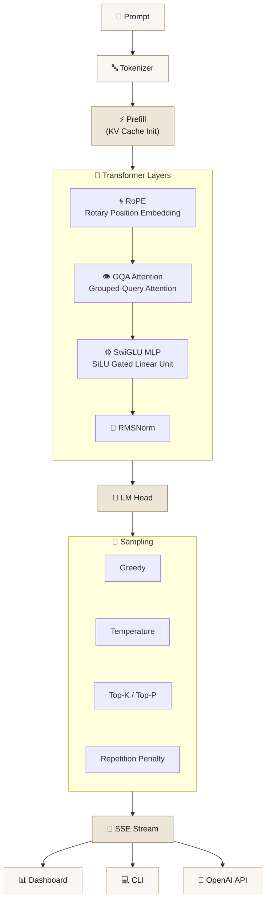
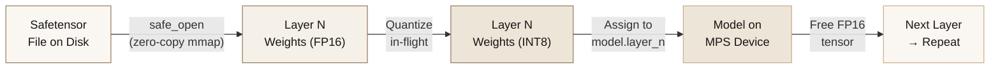

<div align="center">

# ✦ SLM Inference Engine ✦

### *A bespoke SLM inference engine, hand-forged for Apple Silicon*

<br>


<br>

> *A from-scratch transformer inference runtime — no wrappers, no `transformers.generate()`, no shortcuts.*
> *Every RoPE rotation, every GQA head, every SwiGLU gate is hand-written PyTorch,*
> *streaming safetensor weights layer-by-layer to fit a 3B model in 4 GB on a 16 GB Mac.*

<br>

</div>

---

## ◈ Benchmarks

<div align="center">

<table>
<tr>
<td align="center" width="25%">

**Logits Parity**
<br><br>
<code>1.00000179</code>
<br>
<sub>Cosine similarity vs HuggingFace</sub>

</td>
<td align="center" width="25%">

**Qwen2.5-0.5B · M4 MPS**
<br><br>
<code>48.3 tps</code> FP16
<br>
<sub>36.8 ms TTFT · 20.7 ms TPOT</sub>

</td>
<td align="center" width="25%">

**Qwen2.5-3B · M4 MPS**
<br><br>
<code>~15 tps</code> INT8
<br>
<sub>Only 4.13 GB VRAM</sub>

</td>
<td align="center" width="25%">

**KV Cache Speedup**
<br><br>
<code>1.88×</code>
<br>
<sub>With cache vs without</sub>

</td>
</tr>
</table>

</div>

---

## ◈ Architecture Overview



---

## ◈ Supported Architectures

<div align="center">

| Architecture | Models | Status |
|:---|:---|:---:|
| `LlamaForCausalLM` | Llama 2/3, Mistral, CodeLlama | ✅ |
| `Qwen2ForCausalLM` | Qwen 2, Qwen 2.5 | ✅ Active |
| `Phi3ForCausalLM` | Phi-3, Phi-3.5 | ✅ |
| `Gemma2ForCausalLM` | Gemma, Gemma 2 | ✅ |

</div>

---

## ◈ Core Components

### 1 · Multi-Architecture Decoder Runtime

Hand-written PyTorch from the ground up — RoPE with θ = 1,000,000 base frequency, Grouped-Query Attention with `repeat_interleave` for KV head expansion, SwiGLU activation (SiLU gating), and RMSNorm. No `transformers` dependency at inference time.

### 2 · Zero-Copy Memory Streaming

`safe_open` layer-by-layer streaming solves the **13 GB OOM wall** on 16 GB Macs. Instead of materializing the full state dict in memory, weights are streamed directly from safetensor files and quantized in-flight. Drops 3B model peak memory from **13 GB → 4.13 GB**.

### 3 · KV Cache Strategies

| Cache | Description |
|:---|:---|
| `DynamicKVCache` | Grows with sequence length, simplest implementation |
| `StaticKVCache` | Pre-allocated fixed-size buffer for predictable memory |
| `PagedKVCache` | vLLM-style block allocation for efficient batching |
| `PrefixCacheManager` | Trie-based prefix sharing across requests |

### 4 · Quantization Engine

- **INT8** — Symmetric per-tensor quantization with FP16 scale factors
- **INT4** — Group-wise nibble-packed into `uint8`, 2× compression over INT8

### 5 · OpenAI-Compatible API

| Method | Endpoint | Description |
|:---|:---|:---|
| `POST` | `/v1/chat/completions` | Chat completions with SSE streaming |
| `GET` | `/v1/models` | List loaded models |
| `POST` | `/v1/models/load` | Load a model at runtime |
| `GET` | `/v1/models/available` | List available local checkpoints |
| `GET` | `/v1/status` | Engine status & metrics |

### 6 · Interactive Dashboard

Real-time monitoring UI built with Chart.js — TPOT latency graph, TTFT counter, unified memory meter, KV cache gauge, and multi-turn chat with Markdown rendering. Ships as a single `index.html`, served by the FastAPI backend.

### 7 · CLI

```
slm load      Load & quantize a model checkpoint
slm run       Run single-shot inference
slm serve     Launch the API server + dashboard
slm architectures   List supported model architectures
slm status    Show engine status
```

### 8 · LoRA Fine-Tuning

PEFT + TRL pipeline across 4 domains — Medicine, Cinema, C++ Systems Programming, and Research. LoRA rank 64, alpha 128, targeting 8.8M trainable parameters (1.75% of model). Auto-merges adapters to standalone checkpoints for zero-overhead inference.

---

<details>
<summary><strong>◈ Memory Optimization Deep-Dive</strong></summary>

<br>

The central engineering challenge: loading a 3B-parameter model on a 16 GB Mac.

```
┌─────────────────────────────────────────────────────────────────────┐
│  Standard Loading (HuggingFace-style)                               │
│                                                                     │
│  ┌──────────────────┐   ┌──────────────────┐                        │
│  │  Empty Model      │ + │  State Dict       │ = 13 GB Peak         │
│  │  (6.5 GB FP16)   │   │  (6.5 GB FP16)   │                       │
│  └──────────────────┘   └──────────────────┘                        │
│                                                                     │
│  ❌  OOM on 16 GB Mac (macOS needs ~4 GB)                           │
└─────────────────────────────────────────────────────────────────────┘

┌─────────────────────────────────────────────────────────────────────┐
│  SLM Zero-Copy Pipeline                                             │
│                                                                     │
│  ┌──────────────────┐   ┌──────────────────┐   ┌────────────────┐  │
│  │  Empty Model      │ + │  safe_open        │ → │  INT8 Quantize │  │
│  │  (6.5 GB FP16)   │   │  (0 extra memory) │   │  in-flight     │  │
│  └──────────────────┘   └──────────────────┘   └────────────────┘  │
│                                                                     │
│  ✅  4.13 GB on MPS — fits comfortably with headroom               │
└─────────────────────────────────────────────────────────────────────┘
```



</details>

---

<details>
<summary><strong>◈ Math · Rotary Position Embedding (RoPE)</strong></summary>

<br>

RoPE encodes position information by rotating query and key vectors in 2D subspaces:

$$\theta_i = \frac{1}{\text{base}^{\,2i\,/\,d}} \quad \text{where base} = 1{,}000{,}000$$

For position $m$ and dimension pair $(2i, 2i+1)$:

$$\begin{bmatrix} q_{2i}' \\ q_{2i+1}' \end{bmatrix} = \begin{bmatrix} \cos(m\theta_i) & -\sin(m\theta_i) \\ \sin(m\theta_i) & \cos(m\theta_i) \end{bmatrix} \begin{bmatrix} q_{2i} \\ q_{2i+1} \end{bmatrix}$$

The rotation preserves the dot-product structure such that attention scores depend on *relative* position $m - n$, not absolute indices.

</details>

<details>
<summary><strong>◈ Math · Grouped-Query Attention (GQA)</strong></summary>

<br>

GQA reduces KV memory by sharing key-value heads across multiple query heads:

$$\text{num\_kv\_groups} = \frac{\text{num\_heads}}{\text{num\_kv\_heads}}$$

Each KV head is expanded via `repeat_interleave` to match the query head count:

$$K_{\text{expanded}} = \text{repeat\_interleave}(K, \text{num\_kv\_groups}, \dim=1)$$

$$\text{Attention}(Q, K, V) = \text{softmax}\!\left(\frac{Q \, K_{\text{expanded}}^\top}{\sqrt{d_k}}\right) V_{\text{expanded}}$$

This gives Multi-Head Attention quality at a fraction of the KV cache cost.

</details>

<details>
<summary><strong>◈ Math · INT8 Symmetric Quantization</strong></summary>

<br>

Per-tensor symmetric quantization maps FP16 weights to 8-bit integers:

$$\text{scale} = \frac{\max(|W|)}{127}$$

$$W_q = \text{round}\!\left(\frac{W}{\text{scale}}\right) \in [-128, 127]$$

At inference, dequantization reconstructs the approximate weight:

$$\hat{W} = W_q \times \text{scale}$$

The scale factor is stored in FP16, adding negligible overhead (one float per tensor).

</details>

---

## ◈ Quickstart

### Install

```bash
git clone https://github.com/ivin-baiju/Custom_SLM_Inference.git
cd Custom_SLM_Inference
python -m venv .venv && source .venv/bin/activate
pip install -e .
```

### Download & Quantize a Model

```bash
slm load models/checkpoints/qwen2.5-3b --quantization int8
```

### Run Inference

```bash
slm run -p "Explain the mechanism of ACE inhibitors" -m 100
```

### Launch the Dashboard

```bash
slm serve --port 8000
# Open http://127.0.0.1:8000
```

---

## ◈ API Reference

### cURL — Streaming

```bash
curl -N http://127.0.0.1:8000/v1/chat/completions \
  -H "Content-Type: application/json" \
  -d '{
    "messages": [{"role": "user", "content": "What is GQA attention?"}],
    "max_tokens": 128,
    "stream": true
  }'
```

### Python

```python
import requests

response = requests.post("http://127.0.0.1:8000/v1/chat/completions", json={
    "messages": [{"role": "user", "content": "Explain RoPE embeddings"}],
    "max_tokens": 128,
    "stream": False
})
print(response.json()["choices"][0]["message"]["content"])
```

---

## ◈ Repository Structure

```
Custom_SLM_Inference/
├── models/
│   ├── config.py                  # ModelConfig dataclass parser
│   ├── registry.py                # Architecture registry
│   ├── loader.py                  # Zero-copy safe_open streaming loader
│   └── architectures/
│       ├── transformer.py         # RMSNorm, RoPE, GQA Attention, SwiGLU, TransformerBlock
│       ├── llama.py               # LlamaForCausalLM
│       ├── qwen.py                # Qwen2ForCausalLM
│       ├── phi.py                 # Phi3ForCausalLM
│       └── gemma.py               # Gemma2ForCausalLM
├── backends/
│   ├── base.py                    # ExecutionBackend ABC + auto-detection
│   ├── mps.py                     # Apple Silicon MPS backend
│   ├── cuda.py                    # NVIDIA CUDA backend
│   └── cpu.py                     # CPU fallback
├── cache/
│   ├── kv_cache.py                # Dynamic & Static KV Cache
│   ├── block_manager.py           # Paged KV Cache (vLLM-style)
│   ├── prefix_cache.py            # Trie-based prefix caching
│   └── memory_manager.py          # Memory estimation
├── quantization/
│   ├── int8.py                    # Symmetric INT8 quantization
│   └── int4.py                    # Group-wise INT4 quantization
├── runtime/
│   ├── engine.py                  # Main InferenceEngine orchestrator
│   ├── generation.py              # Prefill/decode loop + sampling
│   ├── lifecycle.py               # Model state machine
│   └── request.py                 # GenerationConfig, InferenceRequest
├── server/
│   ├── api.py                     # FastAPI + OpenAI endpoints
│   ├── endpoints.py               # Pydantic schemas
│   └── streaming.py               # SSE streaming generator
├── cli/
│   └── main.py                    # Click CLI (slm commands)
├── dashboard/
│   └── index.html                 # Real-time monitoring + chat UI
├── training/
│   ├── train_lora.py              # LoRA fine-tuning script
│   └── dataset.jsonl              # Multi-domain training data
├── tokenizer/
│   ├── loader.py                  # Tokenizer loading
│   └── processor.py               # Chat template processing
├── monitoring/
│   ├── metrics.py                 # Prometheus metrics
│   └── profiler.py                # Request profiler
├── benchmarks/
│   ├── compare_hf.py              # HuggingFace parity benchmark
│   ├── latency.py                 # Latency benchmarks
│   ├── throughput.py              # Throughput benchmarks
│   ├── memory.py                  # Memory benchmarks
│   └── quant_benchmark.py         # Quantization benchmark
├── tests/                         # 19 passing tests
├── pyproject.toml                 # Package config
└── README.md
```

---

## ◈ Models

<div align="center">

| Model | Parameters | VRAM (INT8) | Throughput | Status |
|:---|:---:|:---:|:---:|:---:|
| Qwen2.5-0.5B-Instruct | 502M | ~480 MB | 48.3 tps | ✅ Verified |
| Qwen2.5-0.5B-Expert | 502M | ~480 MB | 48.3 tps | ✅ Fine-tuned |
| Qwen2.5-3B-Instruct | 3.09B | 4.13 GB | ~15 tps | ✅ Verified |

</div>

---

## ◈ Fine-Tuning & Custom Expert Models

The repository includes a turnkey LoRA fine-tuning pipeline built on PEFT + TRL, specialized across 4 core domains:

- **Domains** — **Medicine & Pharmacology** · **Cinema & Screenplay Theory** · **Systems Programming (C++)** · **Scientific Research Methodology**
- **Dataset** — Formatted conversational training pairs in [`training/dataset.jsonl`](training/dataset.jsonl)
- **Config** — LoRA rank 64, alpha 128, targeting attention projections (`q_proj`, `v_proj`)
- **Trainable** — 8.8M parameters (1.75% of model weights)
- **Training Results** — Cross-entropy loss dropped from **2.744 → 1.566** over 5 epochs
- **Auto-Merge** — Adapters are automatically merged into standalone checkpoints saved to `models/checkpoints/qwen2.5-0.5b-expert/` for zero-overhead inference

### Re-training or Training Your Own Model:
```bash
python training/train_lora.py
```

### Publishing Checkpoints to Hugging Face:
To share your fine-tuned weights publicly:
```bash
huggingface-cli login
huggingface-cli upload your-username/qwen2.5-0.5b-expert models/checkpoints/qwen2.5-0.5b-expert .
```

---

## ◈ Testing

```bash
pytest tests/ -v  # 19 tests, all passing
```

---

## ◈ License

Released under the **MIT License**. See [LICENSE](LICENSE) for details.

---

## ◈ Acknowledgements

- **Qwen Team** (Alibaba Cloud) — Qwen2.5 model weights and architecture documentation
- **PyTorch Team** — MPS backend for Apple Silicon acceleration
- **HuggingFace** — `safetensors` format and `transformers` reference implementations
- **vLLM Project** — PagedAttention inspiration for the paged KV cache

---

<div align="center">

<sub>Built with PyTorch on Apple Silicon · Custom SLM Inference Engine</sub>

</div>
